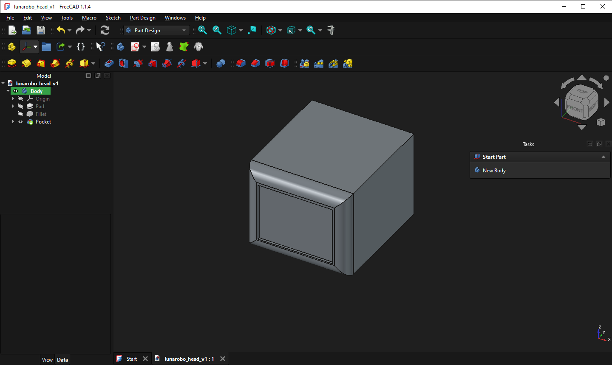

# Objective 
- - - - - - - - - - - 
Designing a compact humanoid AI companion that can sit securely on a person's shoulder.
The robot will combine a digital face, heard, small limbs and joints, camara, audio system and embedded controller or microcontroller.
The design will have stablity, low weight and ill try to make it balanced and small.

# Primary Body layout
- - - - - - - - - - - - - 

 ### Head
 it will contain the digital face.
 It will include the camara and mic too.
 Support Horizantal rotations and a littleee bit of heard tilting.

 ### Torso (main part I would say)
 It will contain the main electronics like the embedded controller, speaker, PCB etc.
 Provide servo points from Arms, legs and head.
 It will be removeable like not that much but we must be able to remove it with un plugging the screws.
 
 ### Arms and legs
 Small articulated or desigined limbs to provide some movements
 Balance (Making balance while being in the shoulder)

 # Mechine system
- - - - - - - - - - - - -

### Head attachment
The head will hold the camera, display and balancing system
Make sure to get available space for wiring connectors and movements.

# Neck
 The neck will provide horizontal rotation and tilting system.

# Torso Attachment
The Torso will suport the head mechanism, limbs and electronics.

The structure of it must have available space for frame, and be open.

# Cableee
wires should be routed away from moving joints and pinch points

There should be space to get the cables flexible and do enough movement.

# what will we do next
 (i) dimensions of front, side, and rear sketches
 (ii) CAD assembly
 (iii) Shoulder mount concept
 (iv) Mechanical clearance
 (v )Make the schematics and pcb

- - - - - - - - - - - - - - - - - - - - - - - - - - 

Head Image: 
 
